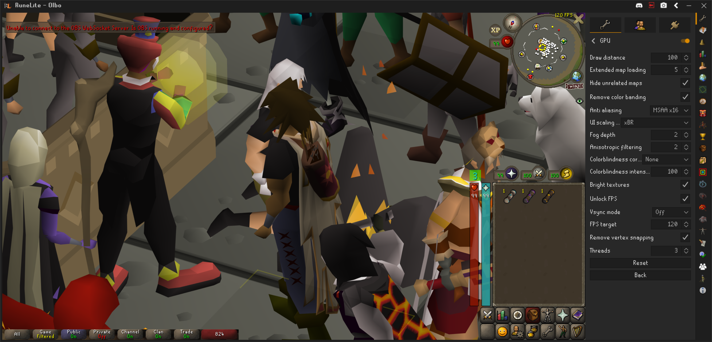

# RuneLite HiDPI

Whole-window RuneLite scaling for KDE Wayland. RuneLite renders at 2× in a
private Xwayland server, then KDE scales it to your display. Tested on CachyOS
at 125%.

Uses the stock Jagex Launcher and RuneLite, with your existing account and
`~/.runelite` settings. Clipboard text works between RuneLite and the desktop.



## Install

Install RuneLite through Jagex Launcher first.

```sh
sudo pacman -S --needed base-devel git
git clone https://github.com/ollieatkinson/runelite-hidpi.git
cd runelite-hidpi
makepkg -si
runelite-hidpi --setup /path/to/Jagex.AppImage
```

Quit Jagex Launcher, then open **Jagex Launcher (RuneLite HiDPI)** and click Play.
Set KDE's X11 scaling to **Apply scaling themselves** and enable RuneLite's
custom window chrome.

## GPU bicubic scaling

Close the HiDPI client and launcher, then run:

```sh
RUNELITE_HIDPI_BICUBIC=1 RUNELITE_HIDPI_BICUBIC_GPU=1 /usr/bin/runelite-hidpi
```

This downsamples on the GPU, with CPU bicubic as a fallback. Check
`~/.local/state/runelite-hidpi/server.log` for `RuneLite filter bicubic GPU:`
to confirm activation. Run `/usr/bin/runelite-hidpi` without these variables
for KDE's usual scaling.

## Known limitations

- Brief black flicker during client startup.
- One RuneLite client per HiDPI launch. Window size is saved; position isn't.
- “Keep game size” needs an unmaximized window. The sidebar can extend past the
  screen edge to keep the game in place.
- Use RuneLite's close button for its exit confirmation; KDE's close action
  can bypass it.
- Dialogs stay inside the outer window. System tray icons aren't supported.
- Large clipboard transfers and images haven't been verified.

## Update

```sh
git pull --ff-only
makepkg -fsi
```

Restart the HiDPI client and launcher after updating.

## Remove

```sh
runelite-hidpi --undo
sudo pacman -R runelite-hidpi
```

Config: `~/.config/runelite-hidpi/`. Saved sizes and logs:
`~/.local/state/runelite-hidpi/`. Don't share `launcher-private.log`; it may
contain account information.
